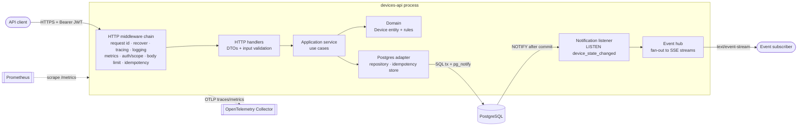

# Architecture

This document describes how the Devices API is structured and records the main
design decisions. Each decision follows a lightweight ADR format: context,
decision and consequences.

## 1. Goals

- Persist and manage `Device` resources through a REST API.
- Enforce the domain rules atomically, even under concurrent requests.
- Notify subscribed clients of state changes only after they are committed.
- Be production ready: secure by default, observable, containerized and easy
  to operate.

## 2. High-level view



## 3. Layers and package layout

The code follows a ports-and-adapters (hexagonal) layout. Dependencies only
point inwards: adapters depend on the application layer, the application layer
depends on the domain, and the domain depends only on the standard library
and a UUID package.

```
cmd/
  api/                  # composition root: config, wiring, graceful shutdown
  tokengen/             # helper CLI that mints JWTs for local development
internal/
  device/               # domain: entity, state machine, rules, domain errors
  app/                  # use cases and ports (Repository, IdempotencyStore)
  httpapi/              # handlers, DTOs, validation, problem+json, middleware
  postgres/             # pgx repository, transactions, migrations (embedded)
  events/               # LISTEN loop, in-process hub, SSE writer
  auth/                 # JWT verification and scope checks
  platform/             # config, logger, telemetry bootstrap
api/
  openapi.yaml          # API contract (source of truth for the HTTP layer)
compose.yaml            # postgres, api and optional observability stack
Dockerfile              # multi-stage build into a distroless image
```

| Layer | Knows about | Must not know about |
|---|---|---|
| `device` | Standard library, `google/uuid` | HTTP, SQL, JSON tags for transport |
| `app` | `device`, port interfaces | `net/http`, `pgx` |
| `httpapi` | `app`, `device` errors | SQL |
| `postgres` | `app` ports, `device` | HTTP |

## 4. Domain model

| Field | Type | Rules |
|---|---|---|
| `id` | UUID (v7) | Generated by the server; time-ordered for index locality |
| `name` | string | Required, trimmed, 1–100 characters |
| `brand` | string | Required, trimmed, 1–50 characters |
| `state` | enum | `available`, `in-use`, `inactive`; defaults to `available` |
| `creation_time` | timestamp (UTC) | Set by the server on create; read-only afterwards |
| `version` | integer | Internal optimistic-locking counter, exposed as the `ETag` header |

### Domain rules

| Rule | Enforcement | HTTP result |
|---|---|---|
| Creation time cannot be updated | A `creation_time` in the body that differs from the stored value is rejected | `422` |
| Name and brand cannot change while the device is `in-use` | Checked against the **persisted** state inside a `SELECT … FOR UPDATE` transaction | `409` |
| A device in use cannot be deleted | `DELETE … WHERE id = $1 AND state <> 'in-use'`, a single atomic statement | `409` |
| Notify only after the state change is persisted | `pg_notify` issued inside the same transaction; PostgreSQL delivers it only on commit | — |

Clarifications:

- The `in-use` rule is evaluated against the stored state, so one request
  cannot move a device out of `in-use` and rename it in the same call. The
  client has to change the state first and then update the name or brand.
- The opposite direction is allowed: a request may rename an `available`
  device and set it to `in-use` at once, because the stored state is not
  `in-use` yet.
- Sending the current value of `name` or `brand` for an `in-use` device is
  treated as a no-op and accepted, so full `PUT` bodies built from a previous
  `GET` keep working.
- Every state transition between the three states is allowed; the brief does
  not restrict them.

## 5. Architecture decision records

### ADR-01: Standard library HTTP server

- **Context:** Go 1.22 added method and wildcard patterns to `http.ServeMux`.
- **Decision:** Use `net/http` with no web framework. Middleware is plain
  `func(http.Handler) http.Handler`.
- **Consequences:** Fewer dependencies, no reflection-based routing and full
  compatibility with the ecosystem (`otelhttp`, `httptest`). Some helpers
  (JSON decoding, error rendering) are written in-house.

### ADR-02: PostgreSQL with pgx

- **Context:** The brief requires a persistent database. The rules need
  row-level locking and atomic conditional writes.
- **Decision:** PostgreSQL 16 accessed through `pgx/v5` (`pgxpool`). SQL is
  written by hand. Schema changes are versioned with `golang-migrate`, with the
  migration files embedded in the binary.
- **Consequences:** Strong consistency and mature tooling. The `pgx` native
  protocol avoids `database/sql` overhead. Indexes on `brand`, `state` and
  `(creation_time, id)` back the filters and pagination.

### ADR-03: State-change notifications with LISTEN/NOTIFY and SSE

- **Context:** Subscribers must receive the device id with the previous and new
  states, and only after the change is persisted. Recovery of missed events is
  out of scope. The API may run with several replicas.
- **Decision:** The update transaction calls
  `pg_notify('device_state_changed', <json>)` when the state changes.
  PostgreSQL holds notifications until commit and drops them on rollback.
  Each replica keeps one dedicated connection running `LISTEN`, forwards
  payloads to an in-process hub, and the hub writes them to every open
  Server-Sent Events stream (`GET /v1/devices/events`).
- **Consequences:**
  - "Only after persisted" is guaranteed by the database, not by application
    ordering.
  - Every replica sees every event, so clients can connect to any instance.
  - No extra broker to run.
  - Delivery is at-most-once: a slow subscriber whose buffer is full is
    disconnected instead of slowing down the others.
  - NOTIFY payloads are limited to 8 KB, which is far above the event size.
  - A durable alternative (transactional outbox and a broker such as NATS or
    Kafka) is listed under future improvements.
- **Runtime details:**
  - The listener uses its own connection, outside the request pool, tagged
    `application_name=devices-api-listener`. It reconnects with exponential
    backoff (0.5 s to 10 s) and pings an idle connection every 30 s so a
    silently dropped link is noticed. `/readyz` reports it as
    `events_listener`.
  - Each stream has a buffer of `EVENTS_SUBSCRIBER_BUFFER` events, and a
    replica accepts at most `EVENTS_MAX_SUBSCRIBERS` streams (`503` beyond).
  - Streams clear the server write timeout, send a keep-alive comment every
    15 s, and are closed on shutdown so the server can drain.
  - `?device_id=` filters a stream to one device.
- **Why SSE over WebSockets:** the stream only goes from server to client. SSE
  runs over plain HTTP, passes through proxies, reconnects automatically in
  browsers and can be tested with `curl`.

### ADR-04: Error format and validation

- **Decision:** All errors use `application/problem+json` (RFC 9457).
  Validation failures return `422` with an `errors` array of
  `{field, code, message}`. Malformed JSON returns `400`. Unknown fields and
  wrong types count as validation failures (`422`). Request bodies are capped
  at 1 MB.
- **Consequences:** Clients get one predictable error shape, and every invalid
  field is reported in a single response.

### ADR-05: Full and partial updates

- **Decision:** `PUT` replaces the mutable fields (`name`, `brand`, `state`).
  `PATCH` accepts JSON Merge Patch (RFC 7396) as
  `application/merge-patch+json`, and `application/json` is accepted as an
  alias. Both support optimistic concurrency through `If-Match` with the
  `ETag` returned by reads; a stale tag returns `412`. `If-Match` is optional.
- **Consequences:** Lost updates are avoided for clients that opt in, and
  simple clients still work without it.

### ADR-06: Cursor pagination

- **Decision:** `GET /v1/devices` is paginated with an opaque cursor that
  encodes `(creation_time, id)` of the last item (keyset pagination).
  `limit` defaults to 20 and is capped at 100. `brand` (exact match, case
  insensitive) and `state` filters can be combined.
- **Consequences:** Constant cost per page regardless of depth, and stable
  results while rows are inserted. Clients cannot jump to an arbitrary page
  number.

### ADR-07: Authentication and authorization

- **Context:** The brief leaves authentication out, but an API that manages
  inventory must not be anonymous.
- **Decision:** Every `/v1` endpoint requires `Authorization: Bearer <JWT>`.
  - The token is verified with `golang-jwt/v5`: RS256/ES256 keys come from a
    JWKS URL in production, and an HS256 shared secret is used locally.
  - The `iss`, `aud`, `exp` and `nbf` claims are validated. Allowed clock skew
    is 30 seconds.
  - `sub` is required. The accepted algorithms are pinned per mode (HS256
    only with a secret; RS, PS, ES and EdDSA only with JWKS), which blocks
    `alg: none` and algorithm-confusion tokens.
  - Authorization uses the space-separated `scope` claim, or the `scp`
    array some identity providers emit:

| Scope | Grants |
|---|---|
| `devices:read` | `GET` endpoints and the event stream |
| `devices:write` | `POST`, `PUT`, `PATCH` |
| `devices:delete` | `DELETE` |

- **Consequences:**
  - A missing or invalid token returns `401`, and a missing scope returns
    `403`.
  - Health, readiness, metrics and documentation endpoints stay public; in
    production they should be reachable only from the internal network.
  - `cmd/tokengen` mints local tokens, so no identity provider is needed to
    try the API. It is built as a separate image target and never ships in
    the API image.
  - The rejection reason is logged, never returned, and the access log
    records the token subject of every authenticated request.

### ADR-08: Idempotency keys

- **Context:** Network retries of `POST /v1/devices` must not create duplicate
  devices.
- **Decision:** `POST` accepts an optional `Idempotency-Key` header (1–255
  printable ASCII characters). The key is scoped to the token subject and
  stored in PostgreSQL with a SHA-256 hash of the request body, the response
  status and body, and an expiry of 24 hours:

| Situation | Result |
|---|---|
| First use | Request runs; response is stored |
| Same key, same body, finished | Stored response is replayed with `Idempotent-Replayed: true` |
| Same key, different body | `422` |
| Same key, first request still running | `409` |

  - The claim is a single `INSERT ... ON CONFLICT` upsert, so two concurrent
    requests with the same key cannot both run.
  - Server errors (5xx) and panics release the key, so the client can retry.
    Client errors (4xx) are recorded and replayed.
  - Only `Content-Type`, `Location`, `ETag` and `Cache-Control` are replayed;
    per-response headers such as `X-Request-ID` are new on every answer.
  - A record left in progress longer than `IDEMPOTENCY_LOCK_TIMEOUT` (a
    replica crashed mid-request) can be claimed again.
  - Expired records are ignored at once and deleted by a periodic job.
- **Consequences:**
  - Retries are safe across replicas and restarts. The cost is two extra
    writes per keyed request.
  - The device insert and the response record are separate statements. If a
    replica dies between them, a retry after the lock timeout creates a
    second device. Writing both in one transaction would close that gap; it
    is listed under future improvements.

### ADR-09: Observability

- **Logs:** `log/slog` with a JSON handler. Every request log carries
  `request_id`, `trace_id`, `span_id`, method, route, status and duration.
  Log keys and messages are in English.
- **Traces:** OpenTelemetry SDK. Instrumentation uses `otelhttp` for inbound
  HTTP and `otelpgx` for queries. Traces are exported over OTLP when
  `OTEL_EXPORTER_OTLP_ENDPOINT` is set; otherwise no exporter is configured.
- **Metrics:** OpenTelemetry metrics API. The Prometheus exporter serves
  `/metrics`, and OTLP export can be enabled with the same environment
  variables. Main instruments:

| Metric | Type | Labels |
|---|---|---|
| `http.server.request.duration` | histogram | `http.request.method`, `http.route`, `http.response.status_code` |
| `devices.created` | counter | — |
| `devices.deleted` | counter | — |
| `devices.state.transitions` | counter | `from`, `to` |
| `devices.events.subscribers` | up-down counter | — |
| `devices.events.dropped` | counter | `reason` |
| `idempotency.replays` | counter | — |
| `db.client.connections.*` | gauges | pool statistics |

- **Health:** `GET /healthz` (liveness, process only) and `GET /readyz`
  (database ping and listener connected).

### ADR-10: Configuration and runtime

- **Decision:** Configuration comes from environment variables only (12-factor)
  and is validated at startup, so a bad configuration fails fast.
  - The server sets read, write and idle timeouts. The streaming endpoint is
    exempt from the write timeout.
  - On `SIGTERM` the process stops accepting connections, closes SSE streams
    and drains in-flight requests within a configurable grace period.
  - The container image is multi-stage, distroless and runs as a non-root
    user.

## 6. Error catalogue

| Status | When |
|---|---|
| `400` | Malformed JSON or an unreadable body |
| `401` | Missing, expired or invalid token |
| `403` | Token lacks the required scope |
| `404` | Device not found |
| `409` | Domain conflict (`in-use` rule) or idempotency key still being processed |
| `412` | `If-Match` does not match the current version |
| `413` | Body larger than 1 MB |
| `415` | Unsupported `Content-Type` |
| `422` | Validation failure, read-only field change or idempotency key reused with a different body |
| `500` | Unexpected error; details are logged, never returned |
