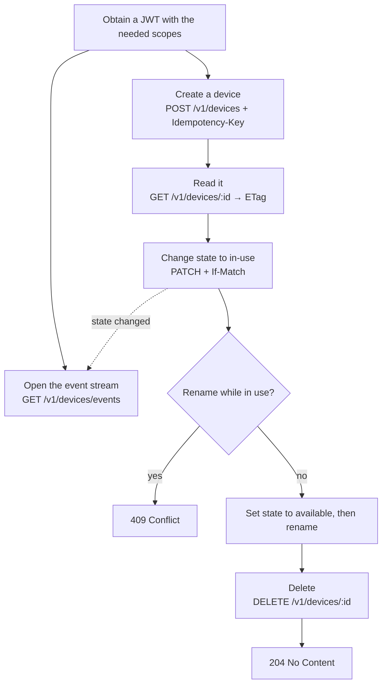
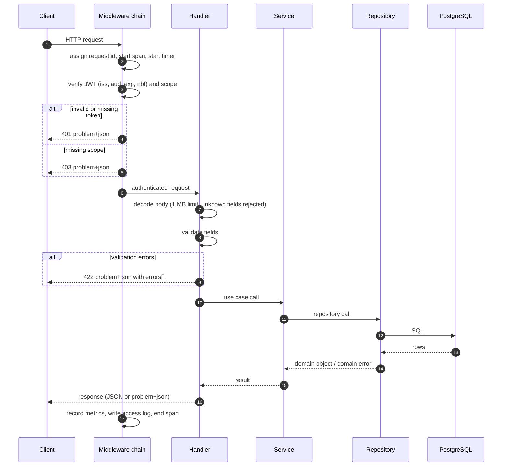
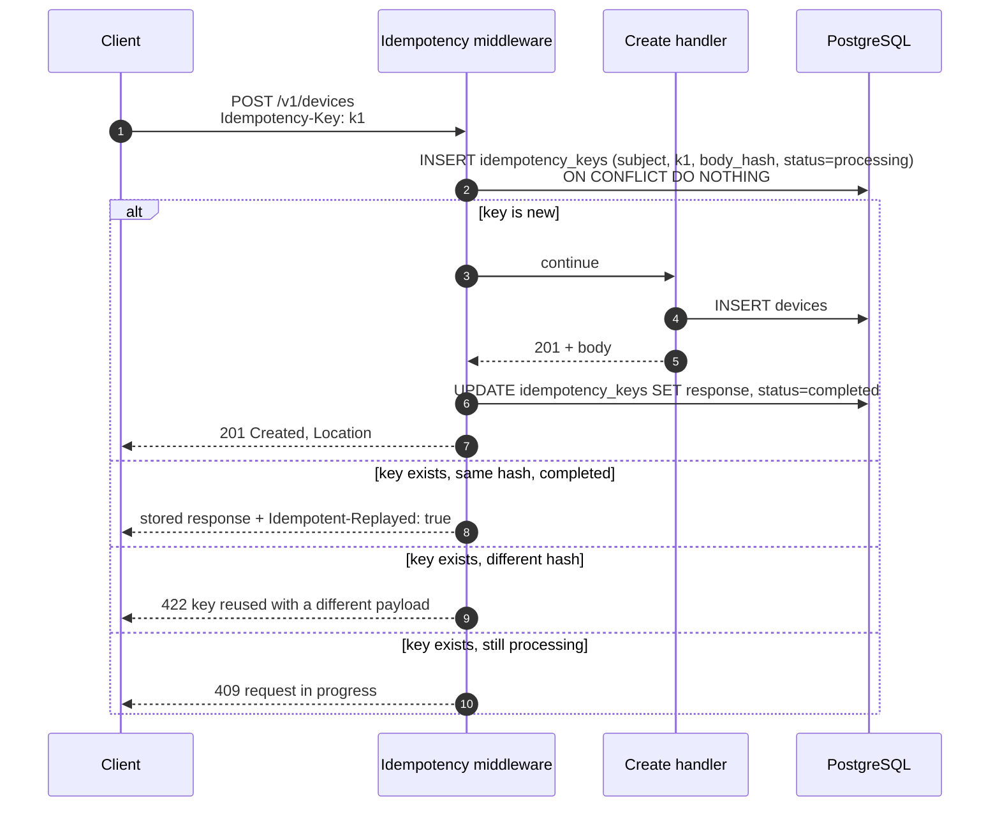
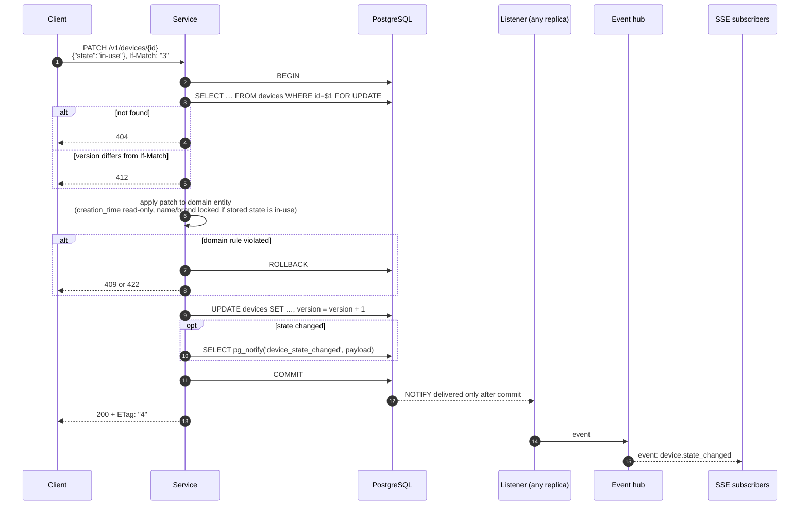
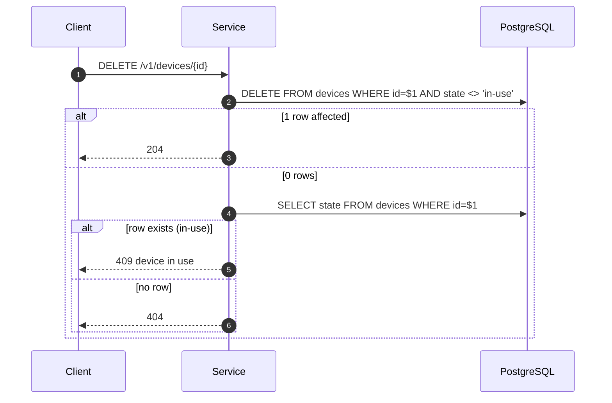
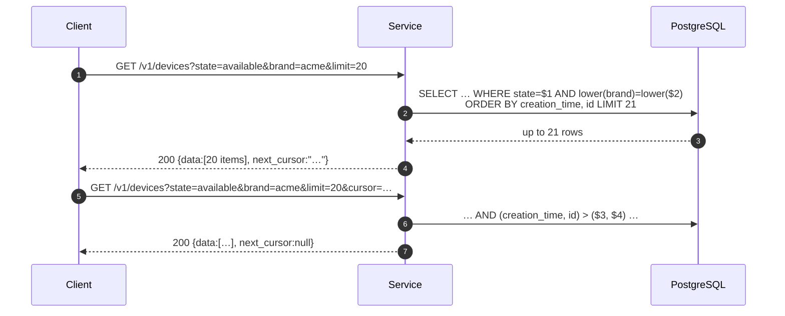
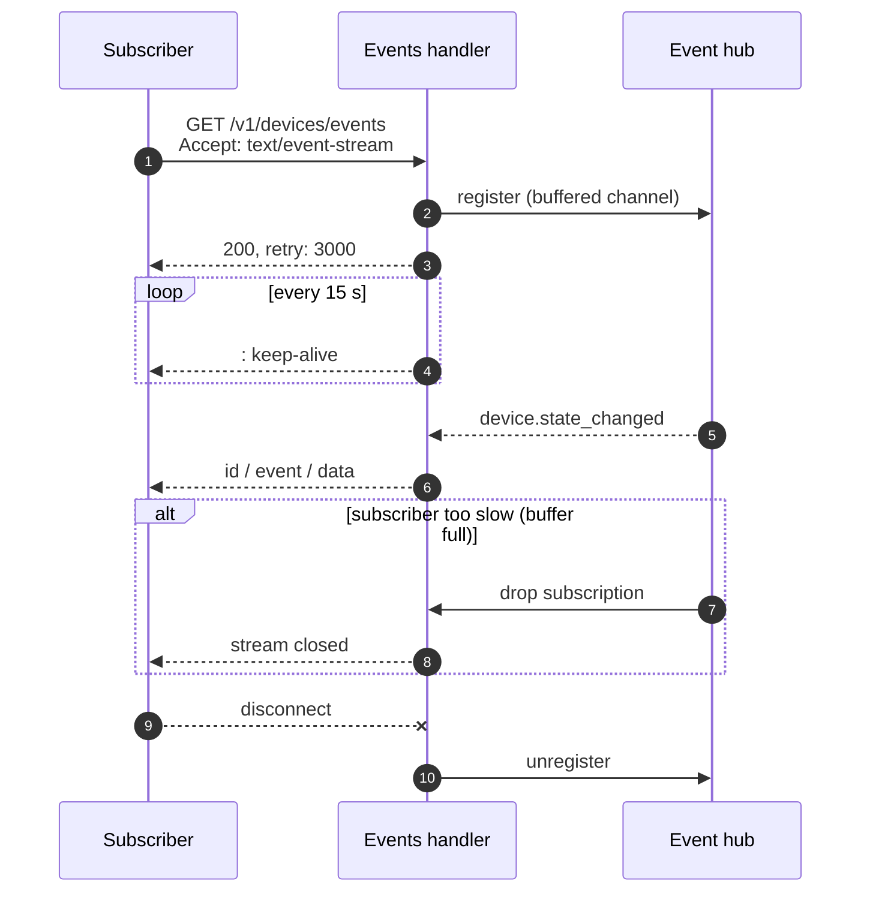

# Usage flows

These sequence diagrams show how each request moves through the system. They
complement the contract in [`api/openapi.yaml`](../api/openapi.yaml) and the
decisions in [`architecture.md`](architecture.md).

## 1. Typical client journey



## 2. Request pipeline (all endpoints)



## 3. Create with an idempotency key



If the handler fails with a server error or panics, the key row is removed,
so a retry can run again. Client errors (4xx) are recorded and replayed like
successes. A row stuck in `processing` for longer than the lock timeout
(the replica died mid-request) can be claimed by the next request.

## 4. Update (PUT or PATCH) with a state change



If the transaction rolls back, PostgreSQL discards the notification, so
subscribers never see a change that was not persisted.

## 5. Delete



The conditional `DELETE` is atomic. The follow-up `SELECT` only chooses the
error code, so it cannot let an `in-use` device be removed.

## 6. Listing with filters and pagination



The query fetches one extra row to know whether another page exists, without
running a separate `COUNT`.

## 7. Event stream



Example event:

```
id: 0192f7a4-6c2e-7c41-9a0b-3f5d8e2a1b77
event: device.state_changed
data: {"event_id":"0192f7a4-6c2e-7c41-9a0b-3f5d8e2a1b77","device_id":"0192f7a1-1d3b-7e55-8c11-2a9f4b6c0d12","previous_state":"available","new_state":"in-use","occurred_at":"2026-10-31T14:05:09.123Z"}
```
